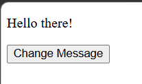
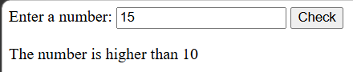
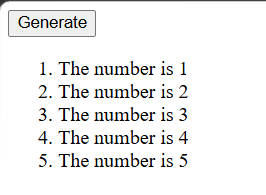

# BIC21203 Web Development — Lab #4a: Client-Side Scripting (JavaScript)

**Name:** [SITI ZAHARAH BINTI MOHAMAD SULTAN]  
**Matric Number:** [AI250247]  

## Overview
This repository contains solutions for Lab #4a focusing on JavaScript functions, DOM manipulation, event handling, input validation, and loops.

## How to Run
1. Clone or download this repository.
2. Open the project folder in VS Code.
3. Navigate to `Q1`, `Q2`, or `Q3` and open `index.html` in a modern browser (or via VS Code Live Server).

## Output Screenshots
### Question 1 — Interactive Text Changer

### Question 2 — Smart Number Validator

### Question 3 — Dynamic Number Generator
